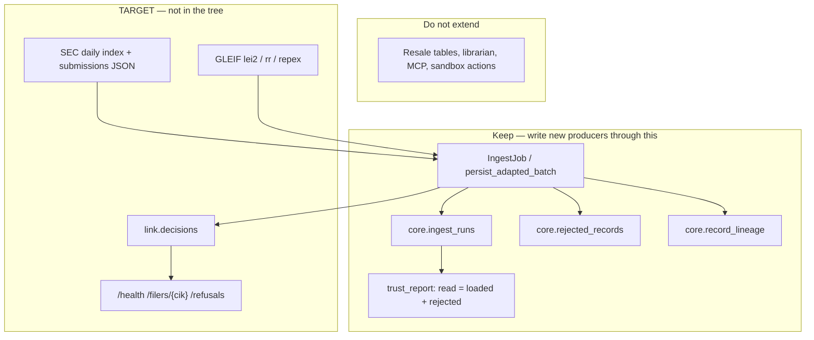

# Architecture

The README is the overview. This file says what the code does today and
what the rebuild reuses.

**CURRENT** is the resale workspace still in the tree. **TARGET** is the
SEC–GLEIF link. TARGET is not implemented.

## What transfers

The runner in `src/cdp_cli/ingest/` already hashes the input, skips an
unchanged success, quarantines rejects, wraps the upserts in one
transaction, and writes a durable `failed` row if the run dies. New SEC
and GLEIF producers call that. They do not get their own loader.

`src/cdp_cli/observability.py` already answers whether `read` equals
`loaded + rejected`, and whether a run was left `running`. `/health`
adds two checks the current report does not have: last SEC index date,
and company-file hash matches the file on disk. A hash mismatch is red.
Links are not to be trusted while it is red.

`src/cdp_cli/llm/grounding.py` already refuses to treat an insufficient
bundle as an answer, and rejects a citation the bundle does not contain.
That rule stays. The librarian loop, the planner, and MCP do not. The
cited answer is a template over `link.decisions` plus a relationship or
an exception. A model may not add a parent.

## CURRENT

PostgreSQL holds a synthetic resale world: items, listings, channels,
orders, notes. Ingest is real. The domain is not the product anymore.

`make demo` still starts that workspace. Do not treat it as the link.

## TARGET

Four layers. A failure in one does not corrupt the one below it.

**Pull.** Two producers. Neither writes canonical rows.

SEC reads `https://www.sec.gov/Archives/edgar/daily-index/`, keeps 10-K,
10-Q, and 8-K, and downloads `https://data.sec.gov/submissions/CIK##########.json`
for those CIKs. `https://www.sec.gov/files/company_tickers.json` is a
ticker helper, not the filing list. Declare a user agent. Stay under 10
requests a second. Store accession, form, and filing date. Do not
download the document.

GLEIF downloads three files, only if the hash changed:

| File | What it is |
|------|------------|
| `lei2` | Who the company is |
| `rr` | Who owns whom |
| `repex` | Why a parent is missing |

Stable URLs: `https://goldencopy.gleif.org/api/v2/golden-copies/publishes/lei2/latest.csv`,
and the same path with `rr` and `repex`. One pull a day.

**Raw.** Immutable. `core.ingest_runs` records the run. New tables hold
the SEC JSON (CIK, fetched time, hash, payload) and the GLEIF publish
(name, hash, path on disk). No zip in git. No 500 MB inside a row.

**Canonical.** Parsed and replaceable from raw.

`sec.filers` is one row per CIK: current name, tickers, and `lei` as
reported, usually null. `sec.filer_names` is the former-name history.
`sec.filings` is one row per accession. No HTML.

`lei.entities` is one row per LEI. Read the header before locking
registration-authority column names. `lei.names`, `lei.relationships`
(`rr`), and `lei.exceptions` (`repex`) follow. A missing parent with an
exception is an answer. It is not a hole to fill.

**Link.** One row per CIK in `link.decisions`. `linked` or `refused`.
Evidence type and a short reason on every row. Candidates considered
and rejected stay on the row. Re-running replaces the decision.

Stop at the first rule that fires:

1. SEC `lei` present, valid, and in the company file. `printed_on_record`.
2. Company record names EDGAR as the registration authority and the
   registered id is this CIK. Confirm the column first.
   `registration_authority`.
3. Normalized legal name matches exactly one issued entity. `exact_name`.
4. A former name matches exactly one issued entity. `former_name`.
5. Else `refused`, with the reason. Two candidates, a near name, a
   lapsed entity, a ticker with no name match.

Ticker never creates a link by itself. It can support a name that
already matched. Normalization is case, punctuation, and a short suffix
list, written down and tested. No similarity score.

## Pages

Not built. Three routes are the whole product.

| Route | Job |
|-------|-----|
| `/health` | Last success, hash match, reconciliation, link counts, refusal counts |
| `/filers/{cik}` | SEC identity, company record, decision in the middle. Refusals are not empty states |
| `/refusals` | The work list |

The answer sits on the filer page. Linked, and a relationship or an
exception exists: say who owns them and cite those rows. Refused:
abstain. Parent not reported: say the exception. A model does not pick
a parent.

## Honesty check

On 2026-10-22, `https://data.sec.gov/submissions/CIK0000320193.json`
returned Apple Inc., tickers `AAPL`, former names present, `lei` null.
Step 1 cannot fire. A later rule may link only if it meets the written
test. A near name is a refusal.

## Technology

| Tech | Decision |
|------|----------|
| PostgreSQL | Only database. Canonical state, audit, link decisions |
| Existing ingest runner | Keep. New producers call it |
| FastAPI | Later, for the three routes. Not the starting point |
| React | Later, if a page needs it. Not the starting point |
| MCP, Redis, DuckDB, Kafka, Spark, Airflow, dbt, a vector index | Not in this rebuild |
| A model | Optional, after the cited template. Not in the link path |

LICENSE stays MIT.
